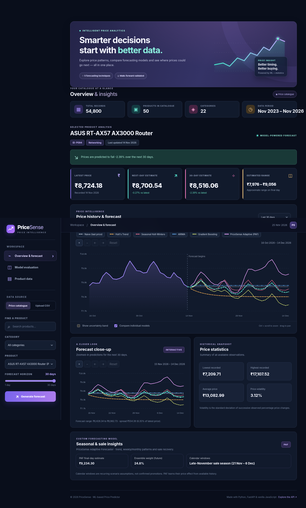
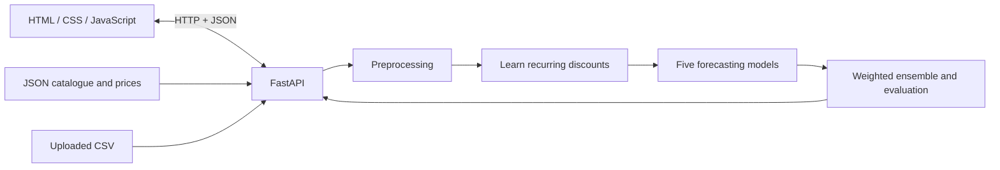

# PriceSense: An ML-Based Price Predictor

**Retail price forecasting • Learned seasonal discounts • Interactive analytics**

PriceSense is a full-stack Python forecasting application that analyzes historical retail prices, detects recurring discount windows and predicts prices for the next 1–30 days. It combines five advanced forecasting models and compares them against a naive baseline.

   



*Dashboard preview from the preceding interactive-charts release. The current release additionally identifies and highlights learned sale windows.*

> **Data provenance:** The bundled catalogue is a reproducible synthetic dataset, not verified retailer price history. Forecasts are estimates, not confirmed promotions or purchasing guarantees. Users can supply their own historical data as CSV.

## Features

- 50 products across 22 categories, with 54,800 daily records (15 Nov 2023–14 Nov 2026).
- 1–30-day forecasts with price direction, uncertainty estimates and model comparison.
- Holt's Trend, seasonal Holt-Winters, ARIMA, Gradient Boosting and custom PriceSense Adaptive Forecaster (PAF).
- Error-weighted ensemble and independent naive last-price benchmark.
- Recurring discount detection from historical observations, including timing uncertainty and recovery.
- Walk-forward calibration, independent 14-day holdout and MAE, RMSE, MAPE and R².
- Interactive charts with zoom, pan, model toggles and hover values.
- CSV import/export, animated loading and responsive layout.

## Architecture



The frontend and API share one server. No React, Node.js, Streamlit, database, API keys or separate frontend host is required.

## Quick start

Use Python **3.13** (the tested and configured deployment version). From the repository root:

```sh
python -m pip install -r requirements.txt
python -m uvicorn pricesense_api_scraper.api:app --host 127.0.0.1 --port 8000
```

On Windows, you can instead double-click `run_pricesense.bat` after installing dependencies. On Linux/macOS use `sh run_pricesense.sh`.

- Dashboard: http://127.0.0.1:8000/
- Swagger API docs: http://127.0.0.1:8000/docs
- Health endpoint: http://127.0.0.1:8000/health

## Deploy online

The included `render.yaml` defines a single free Render web service. Upload the **repository contents** to GitHub (keep `render.yaml`, `requirements.txt` and `frontend/` at its root). On [Render](https://dashboard.render.com/), select New > Blueprint, connect the repository, review the free service and deploy. The dashboard will be available at the service's generated `onrender.com` URL.

Alternatively, create a Python Web Service manually:

| Setting | Value |
|---|---|
| Root directory | Leave blank |
| Build command | `pip install -r requirements.txt` |
| Start command | `python -m uvicorn pricesense_api_scraper.api:app --host 0.0.0.0 --port $PORT --workers 1` |
| Health check | `/health` |
| Plan | Free |

Use the thread environment variables in `render.yaml` if configuring manually. `.python-version` selects Python 3.13. No secrets are required. Free instances sleep after inactivity; the first request may be slow and forecasts are CPU-intensive. The free plan is intended for demonstrations, not production traffic.

See [deployment guide](docs/DEPLOYMENT.md) for detailed instructions and troubleshooting.

## Project structure

```text
PriceSense/
├── frontend/                    # HTML, CSS, JS and favicon
├── pricesense_api_scraper/       # FastAPI and canonical JSON history
├── data/                        # Offline CSV and sale example
├── forecast_engine.py           # Models, validation and ensemble
├── adaptive_forecaster.py       # Custom forecasting and sale detection
├── generate_seasonal_history.py # Reproducible simulated catalogue
├── validation/                  # Historical diagnostic scripts and results
├── tests/                       # Smoke tests
├── .github/workflows/           # Automated GitHub checks
├── docs/                        # Technical and deployment documentation
├── requirements.txt
├── requirements-dev.txt
├── render.yaml
└── run_pricesense.bat
```

## Forecasting methodology

The system prepares a daily time series, transforms prices to logarithms and learns completed multi-day discounts. A recurring event requires evidence from at least two historical years. The model estimates the expected discount profile from observed timing, recurrence, duration and depth. Each advanced model predicts regular prices and receives this learned effect once. Naive repeats the latest raw price.

Ensemble weights are proportional to `1 / (calibration_MAE² + 1e-9)` and normalized to sum to one. The final holdout is separate from weight calibration. The uncertainty band is an approximate error-based range, not a calibrated confidence interval. Historical diagnostic results are mixed; the method does not guarantee improved accuracy for every product.

Read [technical documentation](docs/TECHNICAL.md) for algorithms, API endpoints, dataset generation, validation and limitations.

## CSV input

Required columns: `product_id,product_name,date,price`. Optional columns include `category` and `discount_percent`. Use positive prices and ISO dates (`YYYY-MM-DD`). Files up to 10 MB are accepted. Uploaded data is processed for the request rather than permanently stored. `data/sale_pattern_example.csv` provides a sample.

## Run tests

```sh
python -m pip install -r requirements-dev.txt
python -m unittest discover -s tests -v
```

GitHub Actions runs these checks on pushes and pull requests. Tests cover the web assets, API health, catalogue, 30-day forecast, normalized weights and CSV upload validation.

## Academic project

Developed by Advait and Devang as a B.Tech fifth-semester capstone project at J.C. Bose University of Science & Technology, YMCA, Faridabad.
